# ADHD Coach

A coach on your wrist for the Pebble Time 2. It walks you through routines one step at a time, nudges you to drink water or take a break, warns you about appointments days ahead, runs a Focus timer, catches voice notes, and wakes you up.

Made by Swarmkind ([@swarmkind on X](https://x.com/swarmkind)).

<table>
<tr><td align="center">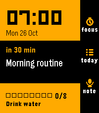<br><sub>Home</sub></td><td align="center">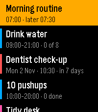<br><sub>Today</sub></td><td align="center">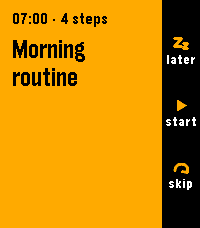<br><sub>Something due</sub></td><td align="center">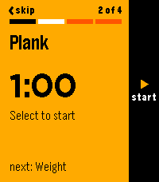<br><sub>A timer step</sub></td></tr>
<tr><td align="center">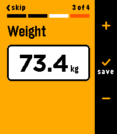<br><sub>Log a number</sub></td><td align="center">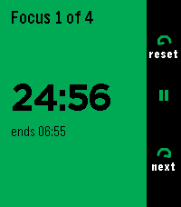<br><sub>Focus</sub></td><td align="center">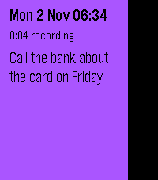<br><sub>A voice note</sub></td><td align="center">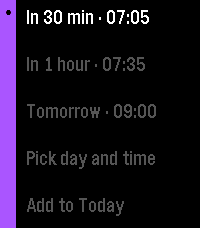<br><sub>Note to to-do</sub></td></tr>
<tr><td align="center">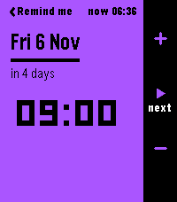<br><sub>Pick a day</sub></td><td align="center">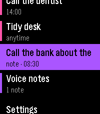<br><sub>To-dos in Today</sub></td><td align="center">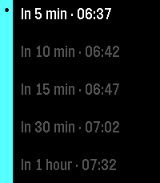<br><sub>Quick alarms</sub></td><td align="center">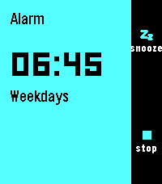<br><sub>Alarm</sub></td></tr>
</table>

## Who it's for

ADHD Coach is designed to help with executive function difficulties, the kind that come with ADHD: losing track of time, stalling at the start of a task, forgetting the middle of a routine, missing appointments you knew about, and ideas that vanish before you can write them down.

It does that by keeping things small and in front of you. The watch shows one thing at a time: the step you're on, the next thing coming up, how long until it starts. It buzzes when something is due and gives you three plain choices: start, later or skip. Nothing needs your phone in your hand.

It is a personal organiser, not a medical device or a treatment.

## What it does

- **Routines**: a list of steps run one screen at a time. Steps can be a simple "done", a countdown timer, or a number to log (weight, reps, mood). Reps, weights and timer lengths can step up over time ("Pushups 20, plus 1 a week"), a step can have an alternative to swap to, and a step can come up only every few days.
- **Reminders**: repeat every so many minutes inside a daily window, with an optional daily goal ("Drink water, every hour, 9 to 9, goal 8").
- **Tasks**: at a set time on chosen days or every few days, or "anytime" in a do-next list.
- **Events**: one-off appointments with a ladder of early warnings (a week before, the day before, the morning of, an hour before).
- **Focus**: a Pomodoro-style timer (25 minutes on, 5 off by default) that can be tied to a task.
- **Voice notes**: speak a thought and it's saved as text. Hold a button on the watch face to start one straight away. Turn one into a to-do with a reminder.
- **Alarms**: up to six, with sound or vibration only, snooze and stop.
- **Today**: everything for today in time order, plus your anytime tasks.
- **Your clock**: the home screen is built to stay up all day as the watch's main screen.

## How to use it

The watch has Back on the left and Up, Select and Down on the right. On most screens a black bar down the right side says what each button does right now, and you can tap its labels too.

- **Select** does the main thing: start, done, save.
- **Hold Select** opens more choices.
- **Back** goes back. On home it does nothing, so you can't leave by accident.

A typical day:

1. **Leave home on screen.** It's your clock: the time, what's next and how soon, today's water count, and your next alarm.
2. **When it buzzes, answer it.** Select starts it or ticks it off, Up is Later, Down skips. Ignore it and it nudges you again, but it never nags forever.
3. **Run a routine one step at a time.** Do the step and press Select. A timer step waits for you, then beeps when the time is up.
4. **Catch a thought.** Press Down on home and speak. To make it a to-do, open Today > Voice notes, hold Select on the note and pick a time.
5. **Focus on one thing.** Up on home opens Focus, and Select starts 25 minutes.
6. **Check Today.** Select on home lists everything due today, your anytime tasks and your to-dos.
7. **Set an alarm.** Hold Select on home, then Alarms. "In 30 min" is one press away.

Your schedule comes from the planner in the phone app (see [Set up your schedule](#set-up-your-schedule)). The full how-to, with a picture of every screen and ideas for using it, is in the **[user guide](docs/guide.md)**.

## Install

You need a **Pebble Time 2** and one of these phone apps:

- **Pebble** by Core Devices (Android and iPhone), the official app.
- **Gravel** (Android, on F-Droid), a de-Googled version of the Pebble app.

ADHD Coach runs on the Pebble Time 2 only.

### From the Pebble appstore

1. Open the Pebble app (or Gravel) and go to the appstore.
2. Search for **ADHD Coach** and install it.

### From GitHub (sideload)

1. On your phone, download `adhd-coach.pbw` from the [latest release](https://github.com/swarmkind/adhd-coach/releases/latest).
2. Open the file with Gravel or the Pebble app. It installs onto the watch.

### Build it yourself

You need the Pebble SDK (`pebble` tool, SDK 4.x).

```sh
pebble build
pebble install --phone <your phone's IP>   # with the phone app's developer connection on
make -C test        # C tests for the core logic
make -C test js     # phone-side tests (Node 22+)
```

Developer notes are in [docs/dev.md](docs/dev.md) and test notes in [docs/testing.md](docs/testing.md).

## Set up your schedule

The watch comes with a sample schedule so you can try it straight away. To make your own, open ADHD Coach's **Settings** in the phone app. That opens the planner, a page built into the app: add routines, reminders, tasks and events, then tap **Save** and they go to the watch.

The planner was tested with Gravel. It should work the same way in Core's Pebble app; please open an issue if it doesn't.

## Privacy

- No account, no server, no tracking. ADHD Coach never uses the internet.
- Your schedule, logs and notes live on the watch and in the phone app's storage for ADHD Coach, nowhere else.
- Voice notes are transcribed by your phone app. Gravel does this on the phone itself. If you use Core's Pebble app, check its dictation settings.
- Export from the planner copies your notes or numbers as text, so you can keep them elsewhere. Uninstalling the phone app deletes what you haven't exported.

## Status

Version 1.5.0. Every screen has been walked through in the Pebble emulator, and the phone pieces it relies on (sideloading, dictation, the built-in planner page) were proven on a real Pebble Time 2 with Gravel. Real-world use is just starting, so if something feels off, please [open an issue](https://github.com/swarmkind/adhd-coach/issues).

## Licence

MIT. See [LICENSE](LICENSE).
