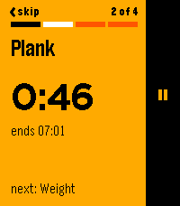
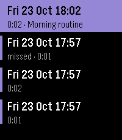
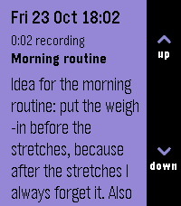

# ADHD Coach user guide

ADHD Coach is a Pebble Time 2 app for people who find executive function hard: starting things, keeping track of time, finishing routines, remembering appointments. This guide shows how each part works and how people use it day to day.

Made by Swarmkind ([@swarmkind on X](https://x.com/swarmkind)).

- [Install](#install)
- [The buttons](#the-buttons)
- [Home screen](#home-screen)
- [Planning on your phone](#planning-on-your-phone)
- [When something is due](#when-something-is-due)
- [Routines](#routines)
- [Reminders and numbers](#reminders-and-numbers)
- [Events](#events)
- [Today](#today)
- [Focus](#focus)
- [Voice notes](#voice-notes)
- [Alarms](#alarms)
- [Settings, sounds and Quiet Time](#settings-sounds-and-quiet-time)
- [Ideas for using it](#ideas-for-using-it)

## Install

You need a Pebble Time 2 and a phone app: **Pebble** by Core Devices (Android or iPhone) or **Gravel** (Android, F-Droid).

**From the Pebble appstore:** open the appstore in your phone app, search for **ADHD Coach**, and install it.

**From GitHub:** download `adhd-coach.pbw` from the [latest release](https://github.com/swarmkind/adhd-coach/releases/latest) on your phone, then open the file with Gravel or the Pebble app. It installs onto the watch.

On first launch the watch fills in a sample schedule (a morning routine, a water reminder, a couple of tasks and a dentist appointment) so you can try everything before you plan your own.

## The buttons

The Pebble Time 2 has Back on the left and Up, Select and Down on the right. On most screens a black bar down the right side labels what Up, Select and Down do right now. You can also tap a label on that bar instead of pressing the button, and hold the middle of the bar for a long Select.

Two habits cover almost everything:

- **Select** is the main action: start, done, save.
- **Hold Select** opens a menu of extra choices.

Lists (Today, voice notes, settings, alarms) also scroll and open with a finger.

## Home screen

Home is meant to stay on screen all day, as your clock:

- The big time and the date, with a bell and the time of your next alarm if one is due within a day.
- The middle shows what's **next** and how soon ("in 30 min"), or what's running **now** (a routine you left part way, or a Focus session).
- The bottom shows today's reminder progress, for example 0/8 glasses of water.

| Button | Does |
|---|---|
| Up | Focus |
| Select | Today |
| Down | New voice note |
| Hold Select | Today, Alarms, or Exit ADHD Coach |
| Back | Nothing, so you can't leave by accident |

Only a watch face can be the watch's default screen, so after a restart, or once you leave the app, the watch shows its face. To get back fast, set Quick Launch (on the watch: Settings > Quick Launch) so that holding a button opens ADHD Coach. If you choose **Hold Down**, holding Down on the watch face goes straight into a new voice note instead.

## Planning on your phone

In the phone app, open ADHD Coach's **Settings**. That opens the planner, a page built into the app, so it works offline. It has four tabs:

- **Schedule**: your routines, reminders, tasks and events. Tap one to change it, or a "New" link to add one.
- **Notes**: your voice notes, to read, rename, delete or export.
- **History**: numbers you logged (weight, pushups) and how each day went, with export.
- **Settings**: Focus lengths and how long "Later" waits.

Tap **Save** when you're done. The changes go to the watch straight away if it's connected, or the next time ADHD Coach opens near your phone.

What you can schedule:

- **Routine**: a set of steps at a time on chosen days. Each step is **Do it** (press done), **Timer** (counts down) or **Number** (log a value).
- **Reminder**: every N minutes between two times, with an optional daily goal. It can ask for a number each time.
- **Task**: one thing at a time on chosen days, or **Anytime**, which puts it in a do-next list with no set time. A timed task can be "fine to start late by" a few minutes.
- **Event**: a date and time with a reminder ladder (see [Events](#events)).

Every item has an alert level. **Normal**, **Important** (a short heads-up first) and **Critical** (the strongest buzz) set how hard it buzzes. **Silent** items show in Today but never buzz.

## When something is due

The watch buzzes and the item fills the screen.

| Button | Task or routine | Reminder | Event warning |
|---|---|---|---|
| Select | Start | Done | Got it |
| Up | Later | Later | Remind me later |
| Down | Skip today | Skip this one | |
| Back | Close (counts as Later) | Close (counts as Later) | Close |
| Hold Select | More choices | More choices | More choices |

"Later" waits 30 minutes for tasks, 10 for reminders and 2 hours for events. You can change those in Settings.

If you don't respond, it buzzes once more after about 30 seconds. A task or routine you ignore gets one automatic Later; if you ignore that too, it shows as **missed** in Today, where you can still start it by hand. Nothing nags you forever.

## Routines

 

A routine shows one step at a time, with a bar along the top for how far through you are and the next step at the bottom.

- **Do it** step: Select when done.
- **Timer** step: counts down and shows when it ends. Select pauses and resumes. At zero it buzzes and moves on.
- **Number** step: Up and Down change the value (hold to go faster), Select saves. It starts at your last value.
- **Back skips** the current step.
- **Hold Select**: Leave, resume later; Finish routine now; Skip routine today.

If you leave part way, home offers to resume it. Timers keep running and buzzing even when you leave the app. At the end, a Done screen tells you what's next.

## Reminders and numbers

A reminder repeats through the day, for example every hour from 09:00 to 21:00. Select counts one towards the goal; when the goal is met, it stops for the day. If it asks for a number (pushups, glasses, a 1 to 10 mood), the number screen comes up after Done. Logged numbers sync to the phone and show in the planner's History tab.

## Events

An event is a one-off appointment with early warnings. Pick a ladder in the planner:

- **Gentle**: the day before, and the morning of.
- **Normal**: a week before, the day before, and the morning of.
- **Persistent**: three weeks, one week, three days and one day before, the morning of, and an hour before.
- **Custom**: any mix.

Early warnings arrive at 09:00 (change it under "Event reminders at") and read like "Dentist in 3 days · Thu 10:30". Select dismisses each one. For an event before 09:00, the morning-of warning comes an hour before instead.

## Today

Select on home opens Today: everything due today in time order, then your anytime tasks, then **Voice notes** and **Settings** at the bottom. Select on an item for Start, Done, Skip today, Later, and for tasks, **Focus on this**.

## Focus

 

Up on home opens Focus. The setup screen shows the focus length and the break. Up and Down change the focus length; tap the left or right half of a row to shorten or lengthen it. Select starts.

While it runs, Select pauses, Down skips to the next phase, and hold Select gives +5 min, Stop, and Lengths. The default is 25 minutes of focus and 5 minutes of break, four times, with a long break of 15 minutes. Each change of phase buzzes, even if you've left the app.

Start Focus from a task with **Focus on this** and the session carries the task's name; when you stop, it asks whether to mark the task done.

## Voice notes

 

Press Down on home (or hold Down on the watch face, if you set up Quick Launch) and speak. It stops when you stop talking, or press Select. A soft buzz means it's saved; there is no screen to confirm, so you can do it half asleep. Your phone app turns the speech into text.

If the phone is out of reach, the watch still saves a "missed note" with the time and length, so you know you had a thought.

Find your notes in Today > Voice notes, newest first. Select opens one; Up and Down scroll. Hold Select to rename it (by speaking a new title) or delete it. All notes also appear in the planner's Notes tab, with export.

## Alarms

 

ADHD Coach has its own alarms, so you never need to leave it. Hold Select on home, then **Alarms**.

- **New alarm** starts at 07:00, every day, with sound.
- The editor goes through hour, minutes, days and sound in turn. Up and Down change the underlined part; Select moves on and saves after the last one; Back steps back. You can also tap a part to pick it.
- Days: once, every day, weekdays, weekends, or one day of the week.
- Sound: **Sound + vibrate** or **Vibrate only**.
- Select on an alarm in the list to turn it on or off, change it or delete it. You can have six.

When it rings: **Up or Back snoozes** for 10 minutes, **Down stops**. A tap on the screen can snooze but never stop, so rolling onto it in bed won't switch it off. It rings for up to ten minutes, then stops on its own. A "once" alarm turns itself off after it's stopped.

Alarms ring through Quiet Time. A sound alarm stays silent if the watch itself is muted; the editor warns you when it is.

## Settings, sounds and Quiet Time

Settings is at the bottom of Today:

- **Later for tasks / reminders / events**: how long "Later" waits.
- **Event reminders at**: the hour early event warnings arrive.
- **Focus, Short break, Long break, Focus cycles**: your Focus defaults.
- **Sounds**: a short tone with each buzz, on to start with; Select turns it off or on. Tones never play while the watch is muted or in Quiet Time.
- **Phone sync**: when the watch last synced with the planner.

The watch's own **Quiet Time** silences reminders and nudges. Events and critical tasks still alert, and alarms still ring.

## Ideas for using it

**A morning routine that doesn't stall.** Make a routine for weekdays at 07:15: "Meds and water" (do it), "Shower" (timer, 8 min), "Get dressed" (do it), "Keys, wallet, phone" (do it). One step on screen at a time means no list to scan and lose your place in, and the timer keeps the shower from eating the morning.

**Medication you can't forget.** A task at 08:00 every day, set to Critical, with "fine to start late by" 30 minutes. It buzzes hard, and if you hit Later it comes back.

**Water and movement.** A reminder every 60 minutes from 09:00 to 21:00 with a goal of 8. The count on home shows how you're doing at a glance, and it stops once you hit the goal. A second one every 2 hours can ask "how many pushups?" and log the number.

**Appointments you knew about but forgot.** An event with the Persistent ladder: warnings three weeks out, a week out, three days out, the day before, the morning of and an hour before. Plenty of time to arrange travel or childcare.

**Starting the boring thing.** Put "Tidy desk" or "Do the tax form" in your anytime tasks. When you have a gap, open Today, pick it, and choose **Focus on this**. Twenty-five minutes with a timer on your wrist is easier to start than "until it's done".

**The 2 a.m. brain dump.** Set Quick Launch to Hold Down. In bed, hold Down, say the thought, let go of it. The watch saves it without lighting up much or asking anything. Read your notes over breakfast in the planner.

**Seeing time pass.** Leave home on screen as your clock. "In 18 min" next to the next item makes time something you can see, not guess.

**Waking up.** A weekday alarm at 07:00 with sound, and a vibrate-only alarm at 09:00 on weekends so you don't wake the house.
