# ADHD Coach user guide

ADHD Coach is a Pebble Time 2 app for people who find executive function hard: starting things, keeping track of time, finishing routines, remembering appointments. This guide shows how each part works and how people use it day to day.

Made by Swarmkind ([@swarmkind on X](https://x.com/swarmkind)).

- [Install](#install)
- [The buttons](#the-buttons)
- [Home screen](#home-screen)
- [Planning on your phone](#planning-on-your-phone)
- [When something is due](#when-something-is-due)
- [Routines](#routines)
- [Reminders and numbers](#reminders-and-numbers)
- [Events](#events)
- [Today](#today)
- [Focus](#focus)
- [Voice notes](#voice-notes)
- [Alarms](#alarms)
- [Settings, sounds and Quiet Time](#settings-sounds-and-quiet-time)
- [Ideas for using it](#ideas-for-using-it)

## Install

You need a Pebble Time 2 and a phone app: **Pebble** by Core Devices (Android or iPhone) or **Gravel** (Android, F-Droid).

**From the Pebble appstore:** open the appstore in your phone app, search for **ADHD Coach**, and install it.

**From GitHub:** download `adhd-coach.pbw` from the [latest release](https://github.com/swarmkind/adhd-coach/releases/latest) on your phone, then open the file with Gravel or the Pebble app. It installs onto the watch.

On first launch the watch fills in a sample schedule (a morning routine, a water reminder, a couple of tasks and a dentist appointment) so you can try everything before you plan your own.

## The buttons

The Pebble Time 2 has Back on the left and Up, Select and Down on the right. On most screens a black bar down the right side labels what Up, Select and Down do right now. You can also tap a label on that bar instead of pressing the button, and hold the middle of the bar for a long Select.

Two habits cover almost everything:

- **Select** is the main action: start, done, save.
- **Hold Select** opens a menu of extra choices.

Lists (Today, voice notes, settings, alarms) also scroll and open with a finger.

## Home screen

 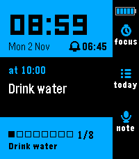 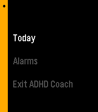

Home is meant to stay on screen all day, as your clock:

- The big time and the date, with a bell and the time of your next alarm if one is due within a day.
- The middle shows what's **next** and how soon ("in 30 min"), or what's running **now** (a routine you left part way, or a Focus session).
- The bottom shows today's reminder progress, for example 0/8 glasses of water.
- Above "focus", a small battery with five bars inside, 20% each. At 20% or less, one red bar is left.

| Button | Does |
|---|---|
| Up | Focus |
| Select | Today |
| Down | New voice note |
| Hold Select | Today, Alarms, or Exit ADHD Coach |
| Back | Nothing, so you can't leave by accident |

Only a watch face can be the watch's default screen, so after a restart, or once you leave the app, the watch shows its face. To get back fast, set Quick Launch (on the watch: Settings > Quick Launch) so that holding a button opens ADHD Coach. If you choose **Hold Down**, holding Down on the watch face goes straight into a new voice note instead.

## Planning on your phone

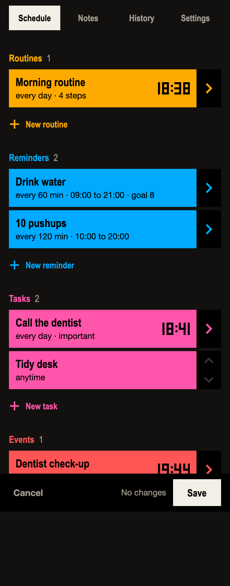

In the phone app, open ADHD Coach's **Settings**. That opens the planner, a page built into the app, so it works offline. It has four tabs:

- **Schedule**: your routines, reminders, tasks and events. Tap one to change it, or a "New" link to add one.
- **Notes**: your voice notes, to read, rename, delete or export.
- **History**: numbers you logged (weight, pushups, curls with their weight) and how each day went, with export. A step's count and weight show together, such as 18 × 12.5 kg.
- **Settings**: Focus lengths and how long "Later" waits.

Tap **Save** when you're done. The changes go to the watch straight away if it's connected, or the next time ADHD Coach opens near your phone.

What you can schedule:

- **Routine**: a set of steps at a time on chosen days, or every few days. Each step is **Do it** (press done), **Timer** (counts down) or **Number** (log a value). A step can grow over time, have an alternative, or come up only every few days (see below).
- **Reminder**: every N minutes between two times, with an optional daily goal. It can ask for a number each time.
- **Task**: one thing at a time on chosen days or every few days, or **Anytime**, which puts it in a do-next list with no set time. A timed task can be "fine to start late by" a few minutes.
- **Event**: a date and time with a reminder ladder (see [Events](#events)).

Every item has an alert level. **Normal**, **Important** (a short heads-up first) and **Critical** (the strongest buzz) set how hard it buzzes. **Silent** items show in Today but never buzz.

### Steps that step up

A **Do it** step can count something. Switch on **Quantity** for reps, **Weight** for a load, or both. Each has four boxes:

- **Today**: what you do now.
- **Increase**: how much it goes up each time.
- **Every**: how often, in weeks or days.
- **Stop at**: where it stops climbing. Leave it blank for no limit.

Pushups at 20, with Increase 1 every 1 week, show 20 today and 21 a week later. A **Timer** step steps up its length the same way, in seconds.

Changing **Today** starts again from the new value. Changing **Increase** or **Every** keeps today's value and counts on from it, so nothing jumps. A weight with **Decimals** 0 that you give a half, such as 2.5, switches to 1 decimal to keep it.

### Alternatives

**Add alternative** gives a step a second choice, with its own quantity, weight and step-ups: curls × 8, or shoulder press × 8. On the watch the step shows "or: Shoulder press" at the bottom. Hold Select and pick **Swap to Shoulder press** to do that one instead.

### Every few days

A step's **Show** can be **Every time** or **Every few days** from a date. Red light every 2 days, starting on a Monday, comes up Monday, Wednesday, Friday and so on. On the days between, the routine leaves it out.

Routines and timed tasks have the same choice under **When**: **On these days**, or **Every few days** from a date. An anytime task has it under **Repeat**. If a step can never fall on a day its routine runs, the planner says so under the steps.

## When something is due

 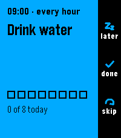 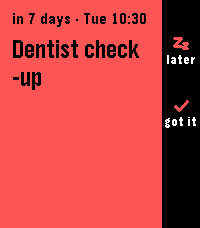

The watch buzzes and the item fills the screen.

| Button | Task or routine | Reminder | Event warning |
|---|---|---|---|
| Select | Start | Done | Got it |
| Up | Later | Later | Remind me later |
| Down | Skip today | Skip this one | |
| Back | Close (counts as Later) | Close (counts as Later) | Close |
| Hold Select | More choices | More choices | More choices |

"Later" waits 30 minutes for tasks, 10 for reminders and 2 hours for events. You can change those in Settings.

If you don't respond, it buzzes once more after about 30 seconds. A task or routine you ignore gets one automatic Later; if you ignore that too, it shows as **missed** in Today, where you can still start it by hand. Nothing nags you forever.

## Routines

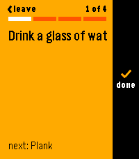  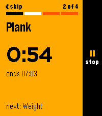  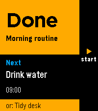

A routine shows one step at a time, with a bar along the top for how far through you are and the next step at the bottom.

- **Do it** step: Select when done.
- **Timer** step: shows its full time and waits until you're ready. Select starts the countdown, Select again stops it, and again carries on. At zero it buzzes, beeps three times and moves to the next step. Up within 5 seconds goes back to it.
- **Number** step: Up and Down change the value, Select saves. It starts at your last value. Holding a button starts slowly and speeds up after 2 seconds.
- **Do it** step with a count: shows today's target, such as "× 21" or "8 × 10.0 kg". Up and Down change how many you did, and Select logs it with the weight. Your count stays if you open the Hold Select menu, or leave and come back.
- A step with an alternative shows "or:" and its name at the bottom. **Swap to** it from the Hold Select menu.
- **Back skips** the current step.
- **Hold Select**: Swap to the alternative, if the step has one; Leave, resume later; Finish routine now; Skip routine today.

Steps that come up every few days appear only on their days, and the bar counts only today's steps. A routine with no steps on a day doesn't come up that day. If you leave part way, home offers to resume it. A change you save in the planner meanwhile shows when you resume, at the same step. Timers keep running and buzzing even when you leave the app. At the end, a Done screen tells you what's next.

## Reminders and numbers

A reminder repeats through the day, for example every hour from 09:00 to 21:00. Select counts one towards the goal; when the goal is met, it stops for the day. If it asks for a number (pushups, glasses, a 1 to 10 mood), the number screen comes up after Done. Logged numbers sync to the phone and show in the planner's History tab.

## Events

An event is a one-off appointment with early warnings. Pick a ladder in the planner:

- **Gentle**: the day before, and the morning of.
- **Normal**: a week before, the day before, and the morning of.
- **Persistent**: three weeks, one week, three days and one day before, the morning of, and an hour before.
- **Custom**: any mix.

Early warnings arrive at 09:00 (change it under "Event reminders at") and read like "Dentist in 3 days · Thu 10:30". Select dismisses each one. For an event before 09:00, the morning-of warning comes an hour before instead.

## Today

 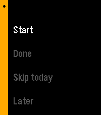

Select on home opens Today: everything due today in time order (an item that repeats every few days shows only on its days), then your anytime tasks, then any notes you turned into to-dos, then **Voice notes** and **Settings** at the bottom. Select on an item for Start, Done, Skip today, Later, and for tasks, **Focus on this**.

## Focus

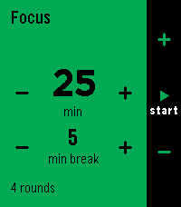  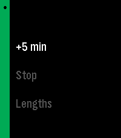

Up on home opens Focus. The setup screen shows the focus length and the break. Up and Down change the focus length; tap the left or right half of a row to shorten or lengthen it. Select starts.

While it runs, Select pauses, Down skips to the next phase, and **Up resets** the current phase to its full length, stopped until you press Select. Hold Select gives +5 min, Stop, and Lengths. The default is 25 minutes of focus and 5 minutes of break, four times, with a long break of 15 minutes. Each change of phase buzzes, even if you've left the app.

Start Focus from a task with **Focus on this** and the session carries the task's name; when you stop, it asks whether to mark the task done.

## Voice notes

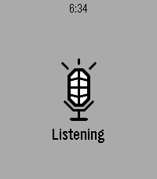 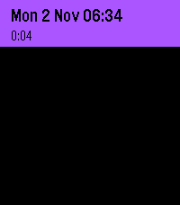 

Press Down on home (or hold Down on the watch face, if you set up Quick Launch) and speak. It stops when you stop talking, or press Select. A soft buzz means it's saved; there is no screen to confirm, so you can do it half asleep. Your phone app turns the speech into text.

If the phone is out of reach, the watch still saves a "missed note" with the time and length, so you know you had a thought.

Find your notes in Today > Voice notes, newest first. Select opens one; Up and Down scroll. Hold Select to rename it (by speaking a new title) or delete it. All notes also appear in the planner's Notes tab, with export.

  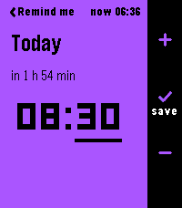

**Turn a note into a to-do.** Hold Select on a note and pick **In 30 min**, **In 1 hour**, **Tomorrow**, **Pick day and time** or **Add to Today**. Each quick choice shows the time it will remind you. Tomorrow uses the planner's "Event reminders at" time, 09:00 unless you changed it (before 5 a.m. it means this morning). **Pick day and time** sets any moment up to a year ahead: Up and Down change the day, then Select moves to the hour and the minutes (5 at a time), and Select again saves. Under the day it says how far off that is, such as "in 4 days". Back steps back, or cancels from the day. The note's first words become a purple to-do in Today. One with a time buzzes then, like a task: Later puts it off by your "Later for tasks" time, Done clears it, and Skip keeps it in Today without reminding. In Today, Select on it to mark it done, give it a new time, or open the note. You can have six at once. They live on the watch only, so the planner doesn't show them.

 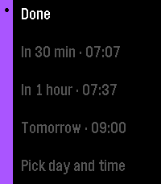 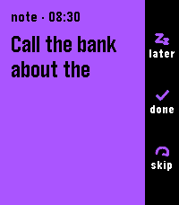

## Alarms

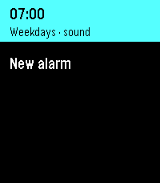  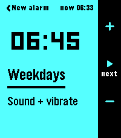 

ADHD Coach has its own alarms, so you never need to leave it. Hold Select on home, then **Alarms**. The time now is at the top of the list.

- **New alarm** offers **In 5 min**, **In 10 min**, **In 15 min**, **In 30 min** and **In 1 hour**, each with the time it will ring. These ring once, to the second, with sound, and disappear once you stop them.
- **Custom** opens the editor, starting at 07:00, every day, with sound. The time now shows at the top right.
- The editor goes through hour, minutes, days and sound in turn. Up and Down change the underlined part; Select moves on and saves after the last one; Back steps back. You can also tap a part to pick it.
- Days: once, every day, weekdays, weekends, or one day of the week.
- Sound: **Sound + vibrate** or **Vibrate only**.
- Select on an alarm in the list to turn it on or off, change it or delete it. You can have six.

When it rings: **Up or Back snoozes** for 10 minutes, **Down stops**. A tap on the screen can snooze but never stop, so rolling onto it in bed won't switch it off. It rings for up to ten minutes, then stops on its own. A "once" alarm turns itself off after it's stopped.

Alarms ring through Quiet Time. A sound alarm stays silent if the watch itself is muted; the editor warns you when it is.

## Settings, sounds and Quiet Time

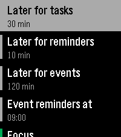

Settings is at the bottom of Today:

- **Later for tasks / reminders / events**: how long "Later" waits.
- **Event reminders at**: the hour early event warnings arrive.
- **Focus, Short break, Long break, Focus cycles**: your Focus defaults.
- **Sounds**: a short tone with each buzz, on to start with; Select turns it off or on. Tones never play while the watch is muted or in Quiet Time.
- **Phone sync**: when the watch last synced with the planner.

The watch's own **Quiet Time** silences reminders and nudges. Events and critical tasks still alert, and alarms still ring.

## Ideas for using it

**A morning routine that doesn't stall.** Make a routine for weekdays at 07:15: "Meds and water" (do it), "Dead hang" (timer, 1 min), "Shower" (timer, 8 min), "Get dressed" (do it), "Keys, wallet, phone" (do it). One step on screen at a time means no list to scan and lose your place in. Each timer waits until you're on the bar or in the shower, then beeps when time's up.

**Medication you can't forget.** A task at 08:00 every day, set to Critical, with "fine to start late by" 30 minutes. It buzzes hard, and if you hit Later it comes back.

**Water and movement.** A reminder every 60 minutes from 09:00 to 21:00 with a goal of 8. The count on home shows how you're doing at a glance, and it stops once you hit the goal. A second one every 2 hours can ask "how many pushups?" and log the number.

**Appointments you knew about but forgot.** An event with the Persistent ladder: warnings three weeks out, a week out, three days out, the day before, the morning of and an hour before. Plenty of time to arrange travel or childcare.

**Starting the boring thing.** Put "Tidy desk" or "Do the tax form" in your anytime tasks. When you have a gap, open Today, pick it, and choose **Focus on this**. Twenty-five minutes with a timer on your wrist is easier to start than "until it's done".

**The 2 a.m. brain dump.** Set Quick Launch to Hold Down. In bed, hold Down, say the thought, let go of it. The watch saves it without lighting up much or asking anything. Read your notes over breakfast in the planner.

**A thought that needs doing.** Halfway through something else you remember the bank. Press Down and say "Call the bank about the card". Then open the note, hold Select, and pick **In 1 hour**. Now it's a to-do with a buzz attached.

**Seeing time pass.** Leave home on screen as your clock. "In 18 min" next to the next item makes time something you can see, not guess.

**Waking up.** A weekday alarm at 07:00 with sound, and a vibrate-only alarm at 09:00 on weekends so you don't wake the house.

**Leaving on time.** About to lose track before an appointment? New alarm, **In 30 min**, and get on with something else.
